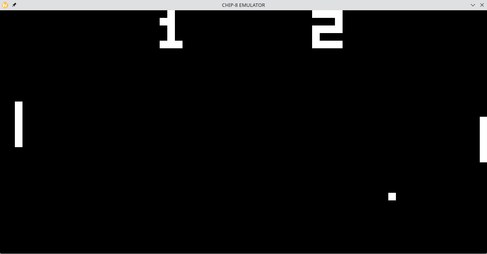
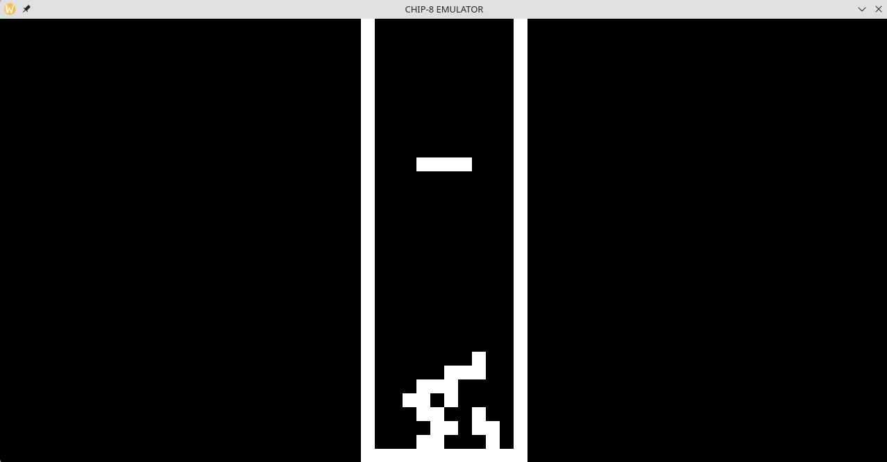
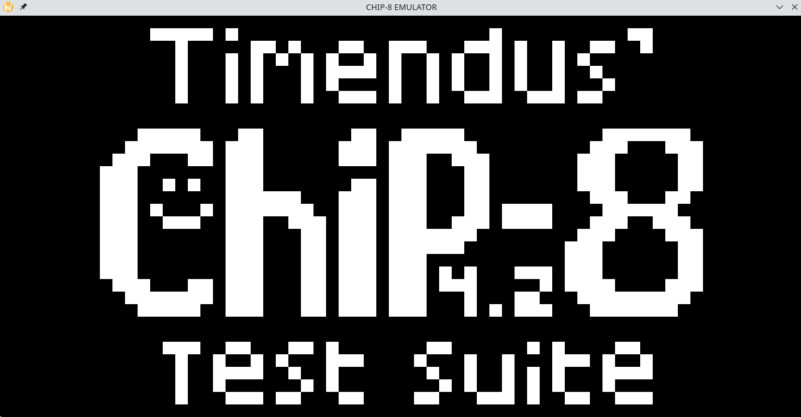
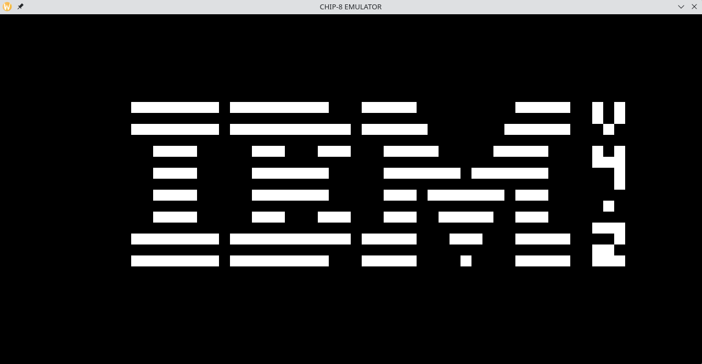
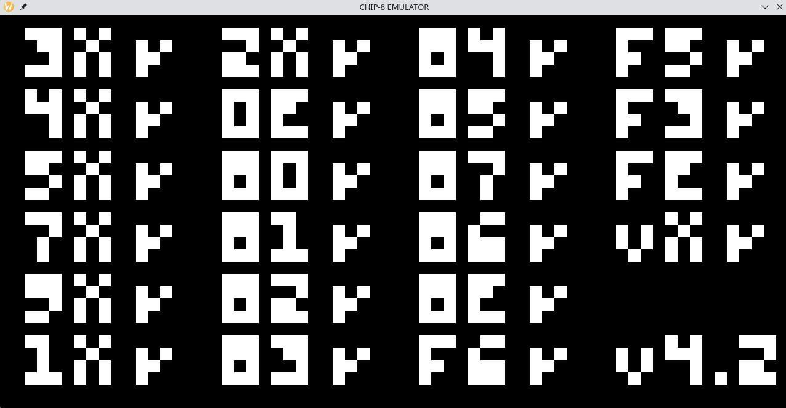
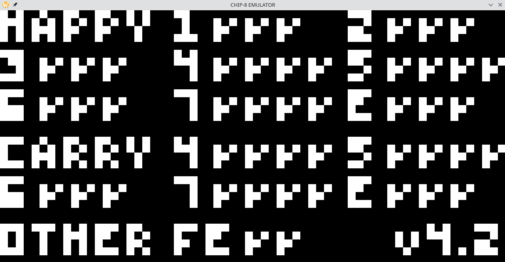

# CHIP-8 Emulator

A CHIP-8 emulator written in C++ for Linux, following [Austin Morlan's CHIP-8 emulator tutorial](https://austinmorlan.com/posts/chip8_emulator/).

I was once told, "If you want to understand a system, then build it yourself."

I wanted to understand what happens underneath the code we write every day: how instructions are executed, how memory is organized, and how a program interacts with hardware-like components such as a display and keyboard. Building a CHIP-8 emulator gave me an opportunity to explore these concepts by implementing a virtual machine myself.

## What I Learned

- **Instruction Execution:** Implemented the fetch-decode-execute cycle and a table-driven opcode dispatch system using C++ member-function pointers to handle CHIP-8's 35 opcodes.
- **Memory Management:** Used fixed-size memory structures to represent the virtual machine's memory, registers, and stack. Implemented stack operations for subroutine calls and returns.
- **Bitwise Operations:** Used bit shifting and masking to decode instructions and manipulate register values.
- **Processor State:** Managed registers, the program counter, the stack pointer, and timers throughout instruction execution.
- **Input Handling:** Implemented a 16-key hexadecimal keypad and mapped keyboard input to CHIP-8 key states.
- **Graphics and Timing:** Implemented pixel-based graphics, display updates, and timing to run CHIP-8 programs.
- **ROM Loading:** Loaded ROM files into virtual memory and executed their instructions through the emulation loop.

## Screenshots

### Pong



### Tetris



### Timendus logo test



### IBM logo test



### Corax+ opcode test



### Flag test



## Technologies

- C++
- Linux
- SDL2
- CMake


## Building and Running

### Requirements

- C++ compiler with C++11 support
- CMake
- SDL2 development libraries
- Git

### Build

```bash
git clone https://github.com/andrescoimbracastedo/CHIP8-Emulator
cd CHIP8-Emulator

mkdir build
cd build

cmake ..
cmake --build .
```

### Run

The compiled executable is placed in the `bin/` directory. From the project root, run:

```bash
cd ../bin
./chip8 20 1 ./Roms/pong.rom
```

The arguments `20` and `1` configure the emulator's execution settings, while the final argument specifies the ROM to load.

Replace `pong.rom` with another compatible CHIP-8 ROM to run a different program.


## Acknowledgements

Built while following Austin Morlan's [Guide to Making a CHIP-8 Emulator](https://austinmorlan.com/posts/chip8_emulator/).

Tested with Timendus' [CHIP8 Test Suite](https://github.com/Timendus/chip8-test-suite/tree/main)
